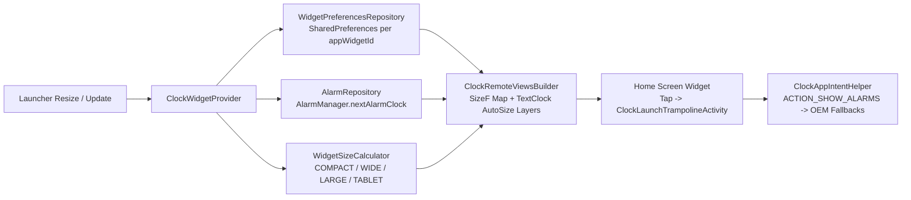

# Chrono Clock — Adaptive Android Home Screen Clock Widget

**Chrono Clock** is a lightweight, battery-efficient Android home screen clock widget built with `AppWidgetProvider` + `RemoteViews` + `TextClock` for the launcher surface and **Jetpack Compose (Material 3)** for clean per-widget configuration and multi-size previewing.

---

## Architecture Choice: `AppWidgetProvider` + `TextClock`

For a digital clock widget with **optional live seconds** and **minute-only battery mode**, native `android.widget.TextClock` inside `RemoteViews` is the most reliable and power-efficient Android approach:

- **Zero background wakeups / IPC throttling:** `TextClock` ticks directly inside the Launcher (`AppWidgetHost`) process.
- **Battery-saving minute mode (`showSeconds = false`):** Uses `"h:mm"` / `"HH:mm"` patterns so `TextClock` updates only on minute boundaries (`ACTION_TIME_TICK`).
- **Live seconds mode (`showSeconds = true`):** Uses `"h:mm:ss"` / `"HH:mm:ss"` patterns; the launcher automatically pauses 1-second updates when the home screen is hidden.
- **Full-bounds scaling (`<= 5%` padding):** Uses `android:autoSizeTextType="uniform"` (`12sp`–`240sp`, `tnum`) inside `match_parent` bounds on API 26+, paired with `RemoteViews(Map<SizeF, RemoteViews>)` on API 31+ (`OPTION_APPWIDGET_SIZES`) and `WidgetSizeCalculator` fallback on API 24–25 so digits fill both phones and wide/sparse tablet grids without clipping.



---

## Key Features

- **4 Widget Picker Presets:** `2×1` (`ClockCompactWidgetProvider`), `4×1` (`ClockWidgetProvider`), `5×1` (`ClockWideWidgetProvider`), and `4×2` (`ClockLargeWidgetProvider`), each freely resizable across phone and tablet grids.
- **Time Formats & Seconds:** System default, forced `12h AM/PM`, or forced `24h` (`tc_ampm` collapses cleanly with `View.GONE` when unused), plus toggleable seconds.
- **Adaptive Date & Weekday:** Localized `TextClock` date (`EEE, MMM d` / `EEEE, MMMM d`) placed `Auto`, `Beside`, `Below`, or hidden.
- **Next Active Alarm:** Reads `AlarmManager.getNextAlarmClock()`, updates on `ACTION_NEXT_ALARM_CLOCK_CHANGED`, and hides automatically (`View.GONE`) when no alarm is set.
- **Typography & Contrast:** `Sans`, `Condensed`, `Monospace`, and `Display (Outfit)` styles; `Light / Regular / Bold` weights; custom text/accent colors; `None / Soft / Strong / Outline` shadow layers; and `Transparent / Frosted / Solid` backdrops.
- **Clean Per-Widget Config UI:** Background-free Material 3 configuration screen (`WidgetConfigActivity`) saved per `appWidgetId` and cleaned up in `onDeleted()`.
- **Safe System Clock Launch:** Uses a BAL-safe `PendingIntent.getActivity` trampoline (`ClockLaunchTrampolineActivity`) falling back across `ACTION_SHOW_ALARMS`, `ACTION_SHOW_TIMERS`, `ACTION_SET_ALARM`, and OEM Clock packages.

---

## Project Structure

```text
app/src/main/
├── AndroidManifest.xml                        # 4 AppWidget receivers, SET_ALARM, <queries>
├── java/com/example/
│   ├── MainActivity.kt                        # Companion dashboard & active widget list
│   ├── data/WidgetPreferencesRepository.kt    # Per-appWidgetId storage & revision Flow
│   ├── model/ClockWidgetConfig.kt             # Config model, GridPreset, WidgetSizeBucket
│   ├── ui/
│   │   ├── MainScreen.kt                      # Pin presets, Clock launch test & Grid Sandbox
│   │   ├── components/ClockWidgetPreview.kt   # Live Compose preview with overflow guard
│   │   ├── config/WidgetConfigActivity.kt     # AppWidget configuration Activity
│   │   ├── config/WidgetConfigScreen.kt       # Minimal Material 3 settings screen
│   │   └── theme/{Color,Theme,Type}.kt        # Material 3 theme & bundled TTF fonts
│   └── widget/
│       ├── AlarmRepository.kt                 # Reads AlarmManager.nextAlarmClock
│       ├── ClockAppIntentHelper.kt            # Safe system Clock intent resolver
│       ├── ClockLaunchTrampolineActivity.kt   # BAL-safe click trampoline
│       ├── ClockRemoteViewsBuilder.kt         # Responsive RemoteViews & shadow layers
│       ├── ClockWidgetProvider.kt             # Providers (2x1, 4x1, 5x1, 4x2) & broadcasts
│       └── WidgetSizeCalculator.kt            # Grid buckets, <=5% padding & pre-O scaling
└── res/
    ├── drawable/                              # Vector icons & widget background shapes
    ├── font/                                  # Inter, Roboto Condensed, JetBrains Mono, Outfit
    ├── layout/                                # compact/wide/large/tablet + 12 TextClock leaves
    ├── values/ & values-v26/                  # Strings, styles & autoSizeTextType="uniform"
    └── xml/                                   # appwidget_clock_{compact,info,wide,large}.xml
```

---

## Testing & Verification

Run the responsive layout & edge-case unit tests:

```bash
gradle :app:testDebugUnitTest --tests "com.example.WidgetSizeCalculatorTest"
```

| Scenario | Expected Behavior | How to Verify |
|---|---|---|
| **No active alarm** | Alarm pill (`alarm_container_*`) is `View.GONE` with no dead space | Toggle *"Simulate No Active Alarm"* in Grid Sandbox or disable alarms |
| **12h vs 24h** | `12h` displays `AM/PM`; `24h` hides `tc_ampm`; `System` tracks OS setting | Switch `Time Format` in `WidgetConfigScreen` or Grid Sandbox |
| **Seconds ON / OFF** | `OFF` uses minute ticks; `ON` auto-scales digits to fit `HH:mm:ss` | Toggle `Show Seconds` across `2×1`..`5×2` & tablet sizes |
| **Phone & Tablet Grids** | `<= 5%` padding and `autoSizeTextType="uniform"` expand digits to frame | Switch picker presets (`2×1`, `4×1`, `5×1`, `4×2`) or resize freely |
| **Missing System Clock** | Falls back through `ACTION_SHOW_ALARMS` -> `ACTION_SET_ALARM` -> OEM -> app | Tap widget or *"Open Clock"* button |
