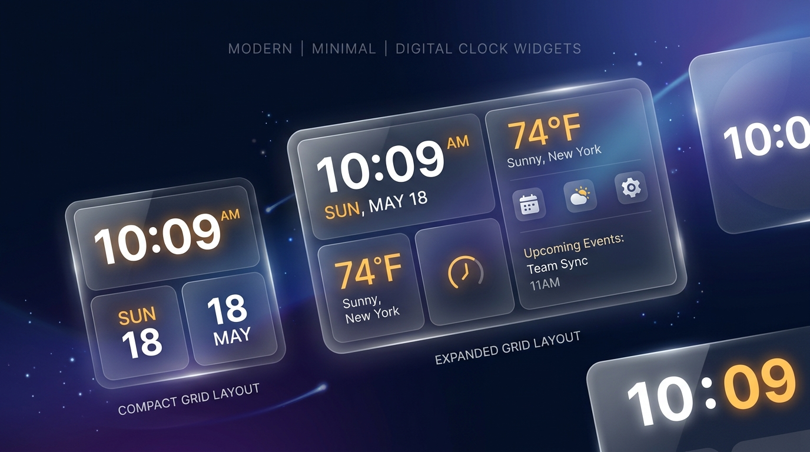
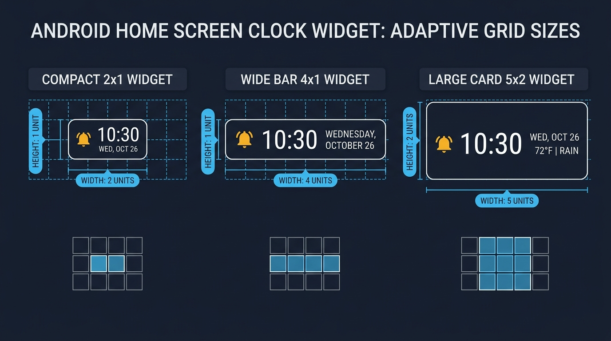
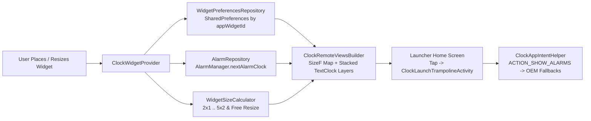

# Chrono Clock — Adaptive Android Home Screen Clock Widget



**Chrono Clock** is a modern, battery-efficient Android home screen clock widget engineered with `AppWidgetProvider` + `RemoteViews` + `TextClock` for the launcher surface and **Jetpack Compose (Material 3)** for interactive configuration and multi-size testing.

---

## Why `AppWidgetProvider` + `TextClock` (Instead of Pure Glance)?

For a clock widget with **optional live seconds** and **minute-only battery mode**, native `android.widget.TextClock` inside `RemoteViews` is the most reliable and power-efficient Android architecture:

- **Zero background wakeups / IPC throttling:** `TextClock` runs directly inside the Launcher (`AppWidgetHost`) process.
- **Battery-saving minute mode (`showSeconds = false`):** Uses `"h:mm"` / `"HH:mm"` patterns so `TextClock` listens only to `ACTION_TIME_TICK` (once per minute).
- **Live seconds mode (`showSeconds = true`):** Uses `"h:mm:ss"` / `"HH:mm:ss"` patterns; `TextClock` automatically pauses its 1-second handler whenever the home screen is off-screen (`onDetachedFromWindow`).
- **True Android 12+ responsive sizing:** Uses `RemoteViews(Map<SizeF, RemoteViews>)` on API 31+ and `onAppWidgetOptionsChanged()` on API 24–30.

---

## Adaptive Grid & Architecture Overview





---

## Key Features

- **Time Formats:** System default, forced `12h AM/PM`, or forced `24h` (`tc_ampm` hides automatically in 24h mode).
- **Seconds Toggle:** Switch between battery-saving minute-only ticks and live 1-second precision.
- **Adaptive Date & Weekday:** Localized `TextClock` date (`EEE, MMM d` or extended `EEEE, MMMM d`) with `Auto`, `Below`, `Beside`, or hidden modes.
- **Next Active Alarm:** Reads `AlarmManager.getNextAlarmClock()` and refreshes immediately on `ACTION_NEXT_ALARM_CLOCK_CHANGED`. Automatically hides (`View.GONE`) when no alarm is scheduled.
- **Typography & Readability:** `Sans`, `Condensed`, `Monospace`, and `Geometric (Outfit)` styles, `Light / Regular / Bold` weights, custom text & accent colors, plus `Soft Shadow`, `Strong Shadow`, and `Crisp Outline` layers for legibility on bright or busy wallpapers.
- **Safe System Clock Launch:** Tapping the widget uses a BAL-safe `PendingIntent.getActivity` trampoline (`ClockLaunchTrampolineActivity`) with multi-step fallback across `AlarmClock.ACTION_SHOW_ALARMS`, `ACTION_SHOW_TIMERS`, `ACTION_SET_ALARM`, and OEM Clock packages.
- **Per-Widget Configuration:** Every `appWidgetId` stores independent settings in `WidgetPreferencesRepository` and cleans up on `onDeleted()`.

---

## Project Structure

```text
app/src/main/
├── AndroidManifest.xml
├── java/com/example/
│   ├── MainActivity.kt                        # Companion dashboard & active widget list
│   ├── data/WidgetPreferencesRepository.kt    # Per-appWidgetId storage & revision Flow
│   ├── model/ClockWidgetConfig.kt             # Config model, presets & color palettes
│   ├── ui/
│   │   ├── MainScreen.kt                      # Pin widget, System Clock test & Grid Sandbox
│   │   ├── components/ClockWidgetPreview.kt   # Live Compose preview across all grid sizes
│   │   ├── config/WidgetConfigActivity.kt     # AppWidget configuration Activity
│   │   ├── config/WidgetConfigScreen.kt       # Real-time configuration UI
│   │   └── theme/{Color,Theme,Type}.kt        # Material 3 theme & bundled TTF fonts
│   └── widget/
│       ├── AlarmRepository.kt                 # Reads AlarmManager.nextAlarmClock
│       ├── ClockAppIntentHelper.kt            # Safe system Clock intent resolver
│       ├── ClockLaunchTrampolineActivity.kt   # BAL-safe click trampoline
│       ├── ClockRemoteViewsBuilder.kt         # Responsive RemoteViews & shadow layers
│       ├── ClockWidgetProvider.kt             # AppWidgetProvider & broadcast handling
│       └── WidgetSizeCalculator.kt            # Grid bucket & typography scaling engine
└── res/
    ├── drawable/                              # Alarm vector, frosted/clear backgrounds, artwork
    ├── font/                                  # Inter, Roboto Condensed, JetBrains Mono, Outfit
    ├── layout/                                # Responsive compact/wide/large + 12 TextClock leaves
    ├── values/ & values-v26/                  # Strings, colors, themes & font styles
    └── xml/appwidget_clock_info.xml           # 2x1..5x2 resize constraints & reconfigurable metadata
```

---

## Testing & Verification

Run local JVM & Robolectric unit tests:

```bash
gradle :app:testDebugUnitTest
```

### Edge-Case Verification Matrix

| Scenario | Expected Behavior | How to Verify |
|---|---|---|
| **No active alarm** | Alarm pill (`alarm_container_*`) is `View.GONE` with zero dead space | Toggle *"Simulate No Active Alarm"* in Grid Sandbox or disable all alarms in System Clock |
| **12h vs 24h** | `12h` displays `AM/PM` badge; `24h` hides `tc_ampm`; `System` follows OS setting | Switch `Time Format` chips in `WidgetConfigScreen` or Sandbox |
| **Seconds ON / OFF** | `OFF` uses `HH:mm` (minute ticks only); `ON` scales down font slightly to fit `HH:mm:ss` without clipping | Toggle `Show Seconds` in `WidgetConfigScreen` across `2×1` and `3×1` chips |
| **Grid Sizes (`2×1` – `5×2`)** | Switches between `COMPACT`, `WIDE` (`BESIDE` / `BELOW`), and `LARGE` editorial layouts | Tap `2×1`..`5×2` chips in-app or resize widget freely on home screen |
| **Missing System Clock** | Safely falls back through `ACTION_SHOW_ALARMS` -> `ACTION_SET_ALARM` -> OEM packages -> Toast + in-app screen | Tap widget or *"System Clock"* button |
